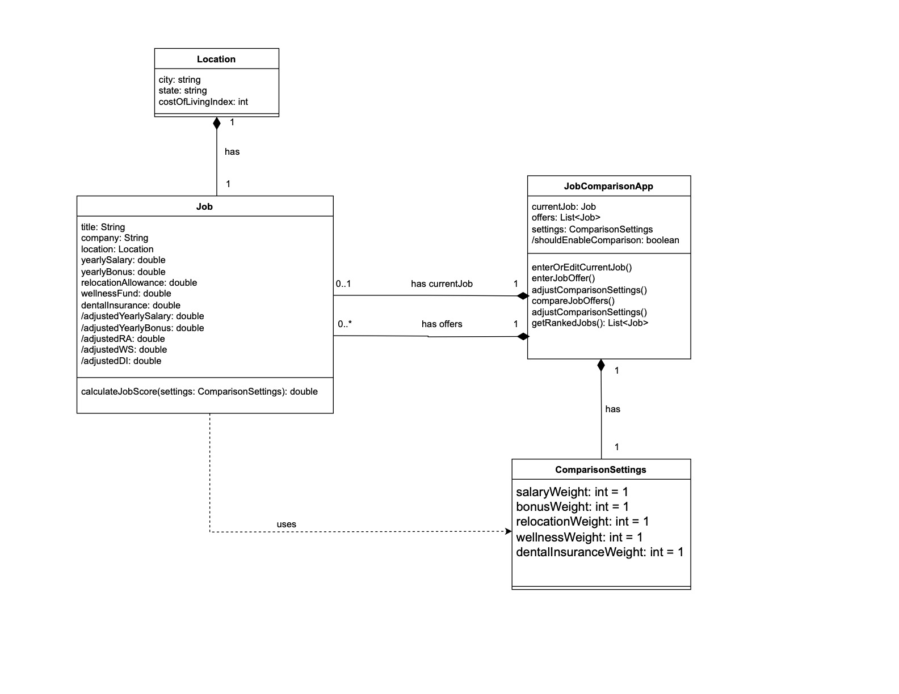
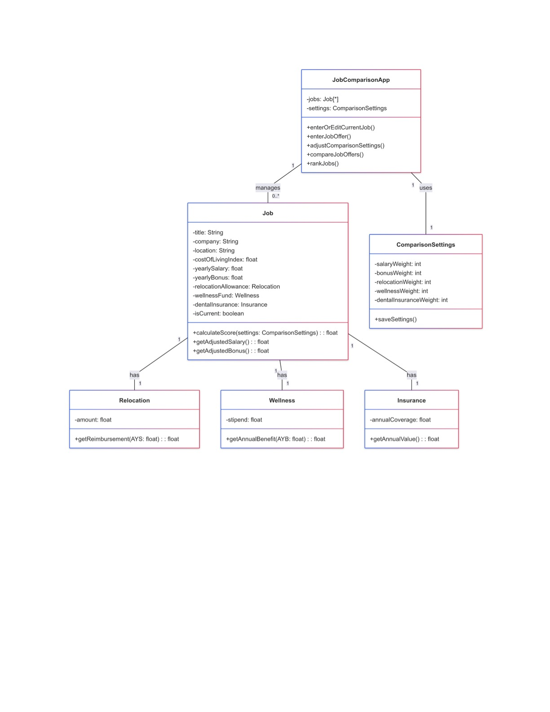
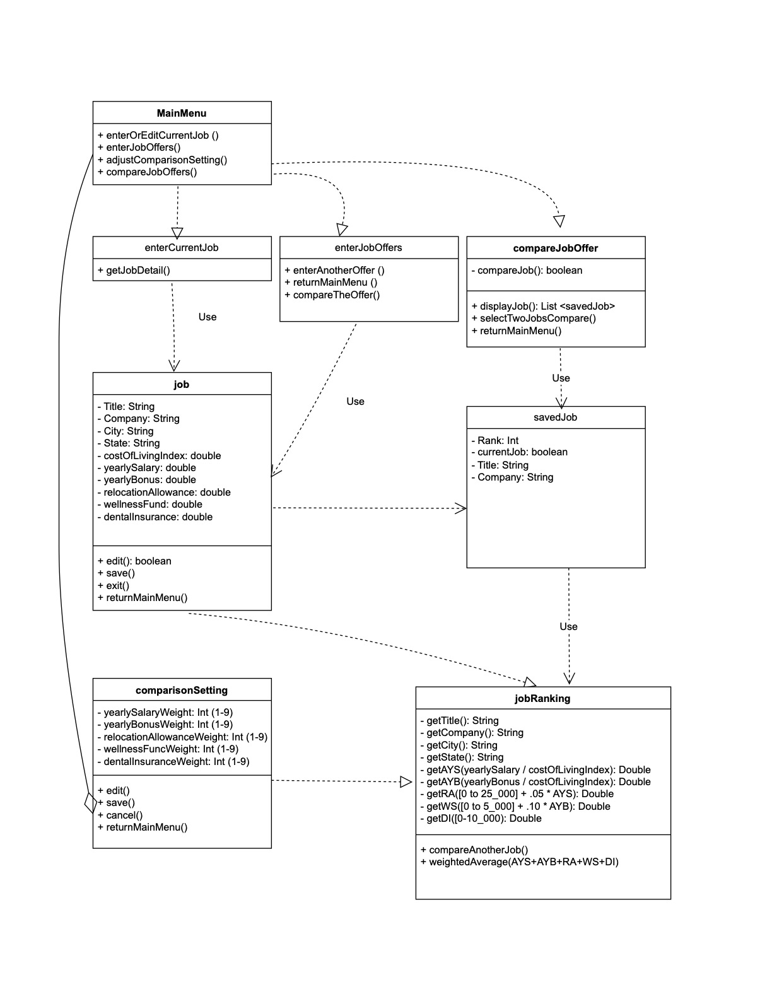
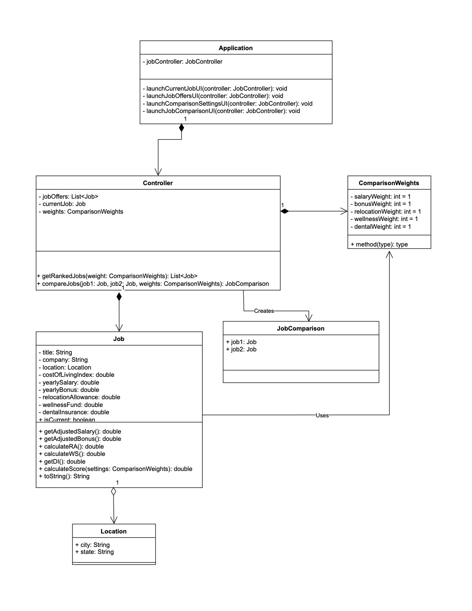
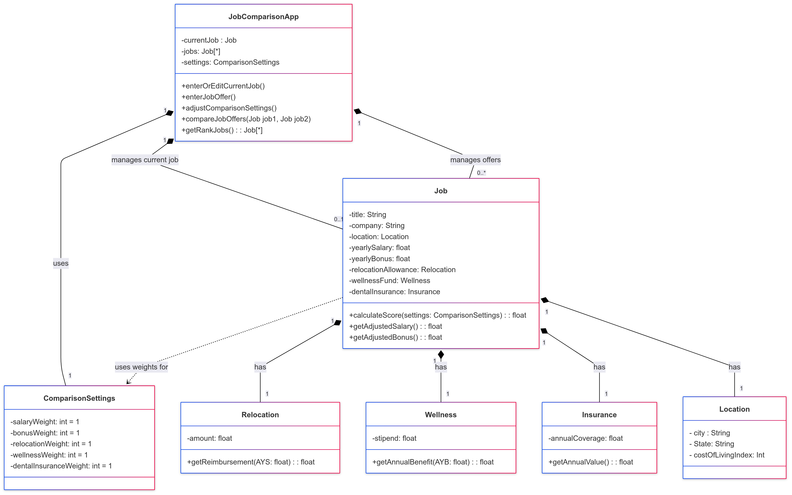

# Design Discussion

## Design 1: Ngoc Nguyen

**Pros:**
- separate class for location
- Correct use of UML relationships and multiplicity

**Cons:**
- Scope can be better separated with separate classes, such as job components (insurance, etc.)
- the duplication of aggregation between Job and JobComparison app is unnecessary

## Design 2: William Hsu

**Pros:**
- Separated calculation logic into individual classes (`Relocation`, `Wellness`, `Insurance`) to maintain clean separation of concerns.
- Maintained proper UI scope by ensuring navigation methods (e.g., return to menu) stayed within UI-related logic.

**Cons:**
- Missing relationship indicators (aggregation, composition, etc.) in the UML diagram.

## Design 3: Jing Wei Zeng

**Pros:**
- Thought ahead in terms of UI, although the details are not necessary

**Cons:**
- Location was split across multiple attributes instead of encapsulated in a single `Location` class.
- UML relationship directions were incorrect (e.g., arrows pointing the wrong way).
- `JobRanking` class was unnecessary; this logic could be included within the `Job` class or comparison utility.
- Included UI-related elements within the `Job` class, which was out of scope for that domain layer.
- Explicit getters/setters were included even though they are typically assumed.

## Design 4: Luke Bedrosian

**Pros:**
- Controller class is UI-forward design (although not necessary)

**Cons:**
- Separate JobComparison class is uneccesary
- Job class has a lot of scope that could be split into smaller classes

---

## Team Design

We chose **Design 2 (William Hsu)** as the base due to its clear modularity and separation of concerns. However, several improvements were made based on insights from other designs and team discussion:

- Replaced the `Location` string attribute with a dedicated `Location` class to improve encapsulation.
- Moved `costOfLiving` to the `Location` class, and clarified that it should be treated as an index (e.g., integer) rather than a monetary value.
- Adjusted method signatures for better usability, such as updating `compareJobOffers()` to accept two `Job` objects directly.
- Changed `rankJobs()` to `getRankedJobs()` to return a ranked list of jobs, simplifying UI interaction and improving flexibility.
- Cleaned up relationship directions and used appropriate aggregation/composition markers to match UML standards.

The final team design balances clarity, modularity, and adherence to object-oriented principles.

---

## Summary

The design discussion process helped us better understand the tradeoffs between different architectural choices. We learned the importance of separating domain logic from UI behavior, properly encapsulating related data (such as using a `Location` class), and adhering to UML standards to avoid ambiguity. Collaboratively reviewing each design brought diverse perspectives, helping us refine our solution into something more robust than any single version. It also gave us a good opportunity to practice constructive feedback and arrive at a consensus efficiently.